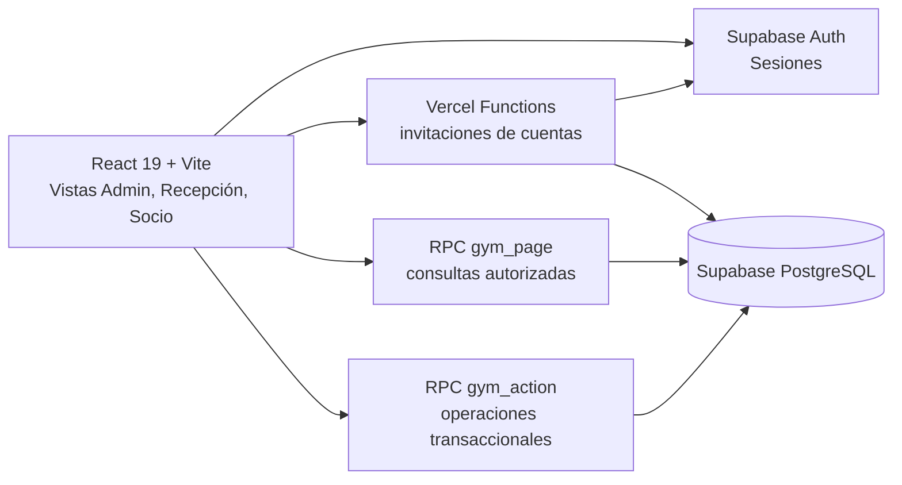
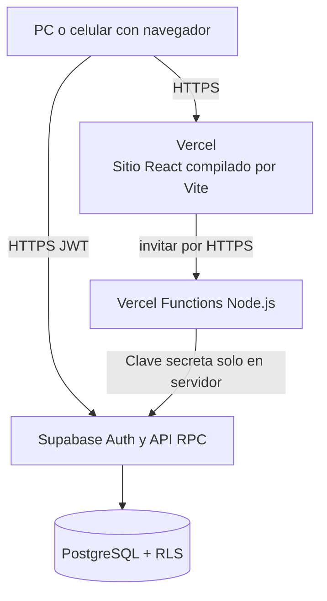
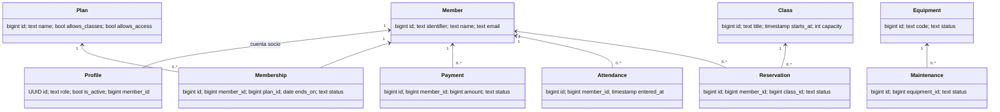

# Propuesta de actualización de los diagramas del informe

El informe EV.II incluye UML de clases, despliegue y componentes. La **lógica de negocio** sigue representada por socios, membresías, pagos, clases, reservas, asistencia y equipos. Como el stack final cambió a React + Vite + Supabase + Vercel, los diagramas de infraestructura originales ya no representan literalmente el despliegue actual. Estos Mermaid son una referencia para rehacerlos en PowerDesigner / herramienta UML cuando actualices la entrega académica.

## Arquitectura de componentes (implementación nueva)

## Despliegue

## Entidades de datos principales

**Nota:** el modelo de deudas/cargos pendiente del CU02/CU09/CU12 no se añadió porque el cliente simulado no fijó tarifas ni conceptos exigibles. El diagrama anterior refleja la estructura de datos **que sí existe** en el ZIP.
